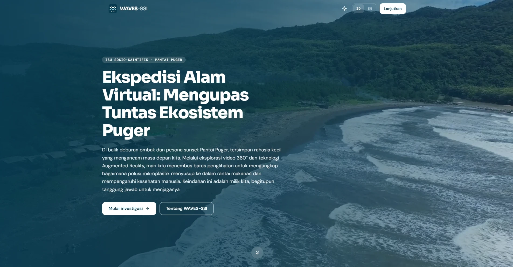
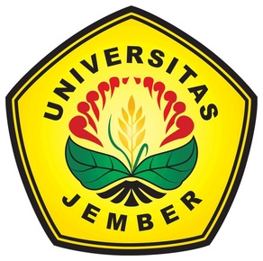
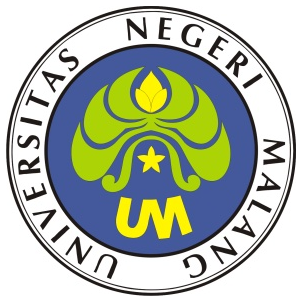

<div align="center">



# 🌊 WAVES-SSI

### Web-based Augmented & Virtual Environmental SSI

*Menyelidiki mikroplastik di Puger, Jember, lewat video 360°, Augmented Reality, dan enam tahap investigasi.*

[](https://waejuc.buroidah.education/)


</div>

---

## 🧭 Tentang website ini

**WAVES-SSI** adalah website pembelajaran untuk mahasiswa calon guru biologi. Website ini mengajak mahasiswa menyelidiki masalah sampah plastik dan mikroplastik di **Pantai Pancer** dan **Tempat Pelelangan Ikan (TPI) Puger, Jember**.

Masalah ini tidak hanya menyangkut sains, tetapi juga kehidupan nelayan, pedagang, dan masyarakat sekitar. Itulah yang disebut *Socio-Scientific Issue* (SSI).

Mahasiswa mengamati kondisi lapangan melalui **video 360°** dan **Augmented Reality (AR)**, lalu mengerjakan enam tahap investigasi bersama kelompoknya.

## 🗺️ Enam tahap investigasi

| # | Tahap | Apa yang dikerjakan mahasiswa |
|:-:|-------|-------------------------------|
| 1 | 💡 **Pemicu Ide Awal** | Menonton video dan mendengarkan pendapat warga setempat |
| 2 | 🧩 **Analisis Data Kualitatif** | Memetakan bagaimana mikroplastik berpindah di lingkungan |
| 3 | 📊 **Analisis Data Kuantitatif** | Membaca data pengukuran dan memperkirakan paparan |
| 4 | 🔬 **Membangun Penjelasan** | Menjelaskan dampaknya bagi tubuh manusia dan ekosistem |
| 5 | ⚖️ **Pengambilan Keputusan** | Merancang solusi yang adil bagi lingkungan dan warga |
| 6 | 🪞 **Refleksi Pembelajaran** | Menilai pengalaman belajar mereka sendiri |

## 🌱 Tujuan

Website ini mendukung **Pendidikan untuk Pembangunan Berkelanjutan** (*Education for Sustainable Development*). Tujuannya agar mahasiswa terbiasa berpikir secara menyeluruh dan peduli pada keberlanjutan, bekal yang bisa mereka bawa ke ruang kelas dan ke masyarakat.

## ✨ Fitur

- 🎥 **Video 360° dan AR** untuk mengamati kondisi lapangan
- 🔒 **Tahap berurutan**: tahap berikutnya terbuka setelah tahap sebelumnya dikirim
- ✍️ **Editor teks kaya** (TipTap) dan **diagram interaktif** (React Flow) untuk menjawab pertanyaan
- 💾 **Draf otomatis**: jawaban tersimpan di perangkat dan bisa dipulihkan jika halaman tertutup
- 📄 **Ekspor PDF** untuk jawaban mahasiswa
- 🌐 **Dua bahasa**: Indonesia dan Inggris
- 🌗 **Mode terang dan gelap**
- 📱 **Responsif** untuk laptop maupun ponsel

## 🛠️ Teknologi

| Bagian | Teknologi |
|--------|-----------|
| Framework | Next.js 16 (App Router), React 19, React Compiler |
| Tampilan | Tailwind CSS 4, Framer Motion, Lucide |
| Formulir | React Hook Form, Yup |
| Editor dan diagram | TipTap, `@xyflow/react` |
| Autentikasi dan data | Supabase |
| Bahasa | i18next |

## 🚀 Menjalankan secara lokal

**Prasyarat:** Node.js 20 dan sebuah proyek Supabase.

```bash
# 1. Pasang dependensi
npm install

# 2. Salin file environment, lalu isi nilainya
cp env.example .env

# 3. Jalankan server pengembangan
npm run dev
```

Buka [http://localhost:3000](http://localhost:3000).

Variabel environment yang dibutuhkan:

| Variabel | Fungsi |
|----------|--------|
| `NEXT_PUBLIC_SUPABASE_URL` | URL proyek Supabase |
| `NEXT_PUBLIC_SUPABASE_ANON_KEY` | Kunci anon Supabase |

### Perintah lain

| Perintah | Fungsi |
|----------|--------|
| `npm run build` | Build produksi |
| `npm start` | Menjalankan hasil build |
| `npm run lint` | Memeriksa kode dengan ESLint |
| `npm test` | Menjalankan tes (Node test runner) |

## 👩‍🏫 Pembuat

Website ini dikembangkan oleh **Hikmah Buroidah, S.Pd., M.Pd.**, dosen Pendidikan Biologi, Universitas Jember (UNEJ), sebagai bagian dari **Tim Peneliti WAEJUC** (*Western Australia–East Java Universities Consortium*).

| Peneliti | Institusi |
|----------|-----------|
| Hikmah Buroidah, S.Pd., M.Pd. (ketua peneliti) | Universitas Jember |
| Prof. Sri Rahayu, Ph.D. | Universitas Negeri Malang |
| Prof. Dr. Mauro Mocerino | Curtin University, Australia |

<div align="center">

<br />


&nbsp;&nbsp;&nbsp;

&nbsp;&nbsp;&nbsp;


<br /><br />

<sub>Dibuat untuk pembelajaran yang peduli pada laut dan masyarakat pesisir. 🌊</sub>

</div>
